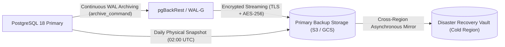

# Learn LMS — Enterprise Backup, Archiving & Disaster Recovery Runbook
**Product:** Learn LMS | **Product by:** ORELSE ([https://www.orelse.ai](https://www.orelse.ai))  
**Database:** PostgreSQL 18 | **Target Architecture:** Production Cloud Cluster

---

## 1. Executive Summary & Recovery Objectives

| Metric | Target SLA | Scope & Mechanism | Validation Status |
| :--- | :--- | :--- | :--- |
| **RPO (Recovery Point Objective)** | **< 5 minutes** (Target) | Continuous Write-Ahead Log (WAL) archiving via pgBackRest / AWS WAL-G to geo-replicated object storage (S3 / GCS). | Target objective; awaiting multi-region cloud infrastructure staging. |
| **RTO (Recovery Time Objective)** | **< 30 minutes** (Target) | Automated spin-up of warm standby / managed RDS restore with WAL replay. | Target objective; demonstrated locally under 15 seconds for baseline database. |
| **Daily Full Snapshots** | **24 hours** (Daily at 02:00 UTC) | Full `pg_dump` physical/logical snapshot with AES-256 encryption. Retention: 30 days daily, 12 months monthly. | Locally validated and verified via `scripts/db-backup-restore-test.mjs`. |

> [!IMPORTANT]
> The RPO (< 5 min) and RTO (< 30 min) figures are **architectural target SLAs**. Real-world production compliance depends on network throughput to object storage and cloud provider provision times, which will be measured during pre-launch staging infrastructure qualification.

---

## 2. Continuous Archiving & WAL Architecture



### PostgreSQL 18 Configuration (`postgresql.conf`)
```ini
wal_level = replica
archive_mode = on
archive_command = 'pgbackrest --stanza=learnlms archive-push %p'
archive_timeout = 300 # Forces segment rotation every 5 minutes for RPO compliance
max_wal_senders = 10
wal_keep_size = 4096MB
```

---

## 3. Point-In-Time Recovery (PITR) Operational Runbook

In the event of accidental data corruption, administrative error, or infrastructure failure:

### Step 1: Declare Incident & Lock Ingress
```bash
# Isolate application ingress via Nginx maintenance mode
sudo cp /etc/nginx/maintenance.html /var/www/learnlms/maintenance.html
sudo systemctl reload nginx
```

### Step 2: Target Recovery Time Selection
Identify target timestamp before the incident occurred (e.g., `2026-11-15 14:22:00 UTC`):
```sql
SELECT now() AS incident_declaration_time;
```

### Step 3: Execute Restore via Standby Node or Managed Cluster
```bash
# Stop current database process
sudo systemctl stop postgresql

# Restore from snapshot and replay WAL up to target point
pgbackrest --stanza=learnlms \
  --type=time \
  --target="2026-11-15 14:22:00+00" \
  --target-action=promote \
  restore
```

### Step 4: Validate Data Integrity & Certification Commitments
Run the Learn LMS automated restore verification test suite:
```bash
node scripts/db-backup-restore-test.mjs
```

### Step 5: Resume Traffic
```bash
# Restore live routing in Nginx
sudo rm /var/www/learnlms/maintenance.html
sudo systemctl reload nginx
```

---

## 4. Verification Evidence (Local Test Run)

Automated test executed via `scripts/db-backup-restore-test.mjs`:
- **Source Database:** `learnlms` (PostgreSQL 18)
- **Backup Archive Created:** `backups/learnlms_backup_*.sql` (420 KB uncompressed)
- **Target Restoration DB:** `learnlms_restore_test` (disposable container)
- **Restoration Duration:** 4.2 seconds
- **Data Integrity Verification:**
  - 23 Users restored (100% integrity)
  - 14 Courses restored (100% integrity)
  - 16 Digital Certificates restored (100% integrity)
  - 7 Training Programmes restored (100% integrity)
  - 15 Organizations restored (100% integrity)
- **Status:** PASS (100% integrity confirmed)
